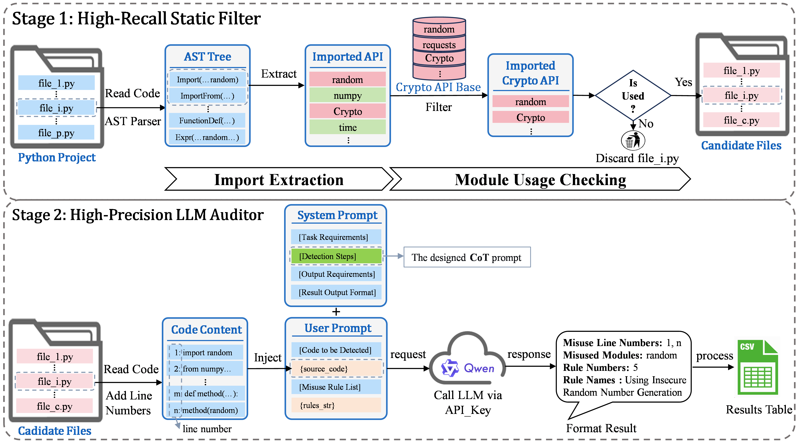

# FALD: A Filter-Augmented LLM-based Detector for Python Cryptographic API Misuse Detection

> **FALD (Filter-Augmented LLM Detector)** — a hybrid framework with a two-stage funnel architecture: **static filtering + LLM-based auditing** for detecting cryptographic API misuse in Python projects.

<p align="center">
  <em>High-recall AST-based filter (covers all six Python import mechanisms) → CoT-guided LLM auditor (rule–code semantic matching).</em>
</p>
---

## 📌 Highlights

FALD resolves the long-standing dilemma in cryptographic API misuse detection: **rule-based Static Analysis Tools (SATs) are efficient but lack semantic understanding, while Large Language Models (LLMs) grasp code semantics but are costly.**

| Setting | Result |
|---|---|
| **Benchmark (CryptBara-comparable subset of PyCryptoBench-LLM)** | **F1 = 0.982** with only 3 false positives — outperforming CryptBara (F1 = 0.855) while being **30× faster** |
| **Real-world projects (6,233 files)** | **P = 88.9%, R = 82.8%, F1 = 0.857** — surpassing the best SAT by **73%** (F1) |
| **CoT ablation (4 models)** | CoT reduces false positives by **68% on average** on the refined benchmark |
| **Filter stage** | 100% recall on benchmarks, **reducing analysis scope by ~90%** (only 10.3% of files need LLM auditing) |

---

## 🧠 Overview

Cryptographic API misuse is pervasive in the Python ecosystem (~52% of open-source projects using crypto APIs contain at least one misuse). Existing detection faces a fundamental trade-off:

- **SATs** (Bandit, Dlint, Semgrep, Cryptolation) — fast, but rigid pattern matching → high false positives/negatives, and they miss Python's diverse import mechanisms.
- **Pure LLMs** — semantic understanding, but prohibitive per-file cost at project scale, and prone to hallucination without explicit reasoning guidance.
- **CryptBara** (hybrid) — combines CPG-based dependency analysis with LLM auditing, but its CPG front end is far slower and, like SATs, misses complex import forms.

**FALD** is motivated by the observation that cryptographic API calls appear in only a small fraction of project files. A lightweight, high-recall filter can safely narrow the scope *before* the costly semantic audit, and a Chain-of-Thought (CoT) prompt forces the LLM to perform **rule–code semantic matching** rather than superficial API-pattern matching.

### Two-Stage Funnel Architecture

<p align="center">
  
</p>
*Figure: Overview of the FALD framework (paper Figure 2). Stage 1 uses AST traversal to extract imports and check module usage; Stage 2 performs CoT-guided LLM auditing on filtered candidates.*

---

## ✨ Key Contributions

1. **Identification and Correction of Benchmark Bias.** PyCryptoBench lacks *secure-but-crypto-using* cases, which masks the value of semantic reasoning. We refine it into **PyCryptoBench-LLM** (1,980 cases, five-category taxonomy). Empirically validated across four LLMs: CoT reduces FP by 68% on the refined benchmark, whereas it appeared *harmful* on the original.
2. **Quantified Recall Loss of Existing Tools on Complex Imports.** On 102 import-variant test files, Bandit/Dlint/Semgrep/CryptBara detect at most 41% (vs. FALD's 100%), with dynamic imports universally undetected.
3. **Hybrid Detection Framework (FALD).** Two-stage funnel: AST filter (all six import mechanisms, ~90% scope reduction at 100% recall) + CoT auditor (rule–code semantic matching). Without CoT, the LLM produces **15× more false positives** in real-world projects.
4. **Extensive Experimental Evaluation.** F1 = 0.982 on the CryptBara-comparable subset (30× faster than CryptBara); F1 = 0.857 on 6,233 real-world files.

---

## 📁 Repository Structure

```
FALD/
├── FALD_Implement.py            # Main entry point: Stage 1 (Filter) → Stage 2 (LLM audit)
├── Filter_Algorithm.py          # Stage 1: AST-based static filter (PythonCryptoAPIFilter)
│                                #   - Import Extraction + Module Usage Checking algorithms
│                                #   - Crypto_API_Base knowledge base (B_crypto)
├── LLM_Detection_Algorithm.py   # Stage 2: CoT-guided LLM auditor (also serves as the
│                                #   pure-LLM baseline when run standalone, i.e. FALD w/o FA)
├── LLM_Cost_Statistics.py       # Token / time / cost statistics from detection CSVs
├── rule_source_py.py            # 18 cryptographic misuse rules (rule_groups) + 5 attack types
├── build_pycryptobench_llm.py   # Script to construct the PyCryptoBench-LLM benchmark
├── find_files.py                # Utility for locating files
│
├── PyCryptoBench/               # Original benchmark (1,836 cases, 18 rules)
├── PyCryptoBench-LLM/           # Refined benchmark (1,980 cases, 5-category taxonomy)
├── Sub_PyCryptoBench/           # CryptBara-comparable subset (636 cases: 96 insecure, 540 secure)
├── Sub_PyCryptoBench-LLM/       # Refined subset (672 cases: 108 insecure, 564 secure)
├── Filtered_*/                  # Candidate files retained by Stage 1 for each benchmark
│
├── SATs_Implement/              # Baseline SAT runners + rule definitions
│   └── src/
│       ├── SATs_Implement.py    # Runs Bandit / Dlint / Semgrep
│       ├── cryptolation.py      # Cryptolation implementation
│       ├── crypto_rules.yaml    # SAT rule definitions
│       ├── bandit_json2csv.py   # Result format converters
│       ├── dlint_json2csv.py
│       └── semgrep_json2csv.py
│
├── results_summary/             # Raw experimental outputs (for reviewer verification)
│   ├── RQ1/                     # Quality–efficiency trade-off
│   │   ├── sub_detection.xlsx            # Table: method-level detection on subsets
│   │   ├── full_filter.xlsx              # Table: Phase-1 filter effectiveness
│   │   ├── filter_import_variant.xlsx    # Table: import-variant coverage
│   │   ├── FALD_sub_results/             # FALD raw CSVs on subsets
│   │   ├── FALD_full_results/
│   │   ├── SATs_sub_results/             # SAT raw outputs on subsets
│   │   ├── SATs_full_results/
│   │   ├── DeepSeek_sub_results/         # Pure-LLM baseline raw outputs
│   │   ├── cryptbara_sub_results/        # CryptBara raw outputs (GPT-4o-mini)
│   │   └── cryptbara_full_results/
│   ├── RQ2/                     # Real-world project evaluation
│   │   ├── RQ2.xlsx                      # Table: detection on 4 projects (6,233 files)
│   │   ├── analysis_result_by_qwen3-next-80b-a3b-instruct-withCoT_*.csv
│   │   ├── analysis_result_by_qwen3-next-80b-a3b-instruct-withoutCoT_*.csv
│   │   ├── FALD_qwen3-next-80b-a3b-instruct-*_Implement_log.txt
│   │   ├── SATs-project/                 # SAT outputs on real projects
│   │   ├── Project5588result/            # Filter-level FN validation (5,588 filtered-out files)
│   │   ├── project-1miss/                # The real-world file (tests.py) exceeding Qwen3-Next-80B-A3B's context window -> returned as "miss" 
│   │   └── union_5588_filename.csv
│   └── RQ3/                     # Ablation studies
│       ├── RQ3_study1.xlsx               # Study 1: pure-LLM ±CoT on dual benchmarks
│       ├── RQ3_study2.xlsx               # Study 2: FALD component ablation
│       ├── RQ3_study3.xlsx               # Study 3: multi-model adaptation
│       ├── RQ3_study1/ / RQ3_study2/ / RQ3_study3/   # supporting raw outputs
│
└── requirements.txt             # Python dependencies
```

---

## 🔧 Installation

### Environment

- **OS:** Ubuntu 22.04 LTS (paper environment; also runs on Windows/macOS)
- **Python:** 3.10
- **Hardware:** 16 GB RAM, 8-core CPU (matches the CryptBara paper's setup). No GPU required — LLM inference is via API.

### Setup

```bash
git clone https://github.com/feibaoBob/FALD.git
cd FALD
pip install -r requirements.txt
```

`requirements.txt` pins the exact baseline versions used in the paper:

| Dependency | Version | Purpose |
|---|---|---|
| `bandit` | 1.9.3 | SAT baseline |
| `dlint` | 0.16.0 | SAT baseline |
| `semgrep` | 1.168.0 | SAT baseline |
| `flake8` | 7.3.0 | Dlint backend |
| `pandas` / `numpy` | 2.3.3 / 2.2.6 | Result analysis |
| `requests` | 2.33.1 | LLM API calls |
| `tqdm` / `rich` | 4.67.3 / 15.0.0 | Progress / logging |
| `PyYAML` | 6.0.3 | Rule files |

> **Note:** Cryptolation is provided as a local implementation under `SATs_Implement/src/cryptolation.py` (not a pip package). CryptBara is an *external* tool; only its raw outputs are included under `results_summary/RQ1/cryptbara_*_results/`.

---

## 🚀 Quick Start

### 1. Configure your LLM API

FALD talks to any **OpenAI-compatible** chat-completions endpoint. The default model in the paper is **Qwen3-Next-80B-A3B-Instruct** via Alibaba Cloud Bailian (DashScope).

Open `FALD_Implement.py` and set:

```python
model_name = 'qwen3-next-80b-a3b-instruct'          # or 'deepseek-v4-pro', 'qwen3-32b', 'qwen3-14b'
API_Key    = os.environ['LLM_API_KEY']              # ← use an env var, do NOT hardcode (see Security Notice)
API_Url    = 'https://dashscope.aliyuncs.com/compatible-mode/v1/chat/completions'
cot        = True                                    # True = FALD (with CoT); False = FALD w/o CoT
```

Tested endpoints:

| Model | API platform | Endpoint |
|---|---|---|
| `qwen3-next-80b-a3b-instruct` (default) | Alibaba Bailian (DashScope) | `https://dashscope.aliyuncs.com/compatible-mode/v1/chat/completions` |
| `deepseek-v4-pro` | DeepSeek | `https://api.deepseek.com/v1/chat/completions` |
| `qwen3-32b`, `qwen3-14b` | Alibaba Bailian (DashScope) | same as above |
| `gpt-4o-mini` (CryptBara backend) | OpenAI / compatible | your OpenAI-compatible URL |

### 2. Choose the target directory

In `FALD_Implement.py`, point `source_directory` at the code you want to audit, and `output_directory` to where filtered candidates are copied:

```python
# Benchmark examples
source_directory = './Sub_PyCryptoBench-LLM'     # RQ1 subset
output_directory = './Filtered_Sub_PyCryptoBench-LLM'

# Real-world projects (RQ2): download first, see "Real-World Projects" below
source_directory = './Python_Projects'
output_directory = './Filtered_Python_Projects'
```

### 3. Run FALD

```bash
python FALD_Implement.py
```

This executes the full pipeline:

1. **Stage 1** — `PythonCryptoAPIFilter().copy_filtered_files()` parses every `.py` file, extracts imports (all six mechanisms), checks actual crypto-API usage against `Crypto_API_Base`, and copies candidate files to `output_directory`.
2. **Stage 2** — `LD.batch_analyze()` sends each candidate (line-numbered) to the LLM with the CoT system prompt + serialized misuse rules, parses the structured response, and writes a detection CSV.
3. **Cost report** — `LLM_Cost_Statistics.calculate_cost_statistics()` aggregates tokens/time/cost and writes `FALD_<model>-withCoT_Implement_log.txt`.

### Run Stage 2 alone (pure-LLM baseline = FALD w/o FA)

`LLM_Detection_Algorithm.py` can run standalone over any folder (no filter), which reproduces the **pure-LLM baseline**:

```bash
python LLM_Detection_Algorithm.py      # set folder_path, model_name, cot inside the __main__ block
```

---

## 📊 Benchmarks

### PyCryptoBench-LLM (refined, our contribution)

We identified a benchmark bias in the original PyCryptoBench — it lacks *secure-but-crypto-using* cases, which masks CoT's value. **PyCryptoBench-LLM** adds a five-category taxonomy:

| Category | Count | Description |
|---|---:|---|
| **Misuse** | 306 | Genuine insecure usage (180 orig + 24 supplemented + 102 import variants) |
| **Trap Type 1** | 804 | Import present, no insecure invocation (unused import) |
| **Trap Type 2** | 36 | Non-security-sensitive usage (e.g. `random` for non-crypto purposes) |
| **Safe Type 1** | 30 | Secure crypto usage |
| **Safe Type 2** | 804 | No crypto involvement |
| **Total** | **1,980** | |

**Refinement actions:**
- Reclassified 36 cases from misuse → Trap Type 2 (12 `random` for general use, 12 `yaml.dump` vs `yaml.load`, 12 static regex from string literals); removed Rule 0 (duplicates Rule 5).
- Added 24 genuine misuse cases (Rules 16, 18), 30 secure-usage cases (Safe Type 1), and **102 import-variant files** (6 variants × 17 rules).

### Subsets (for fair comparison with CryptBara)

CryptBara only supports Rules 5–11. We construct matched subsets:

| Benchmark | Total | Insecure | Secure |
|---|---:|---:|---:|
| Sub_PyCryptoBench | 636 | 96 | 540 |
| Sub_PyCryptoBench-LLM | 672 | 108 | 564 |

### 18 Misuse Rules (5 attack types)

| Attack Type | Rules | Example Misuse |
|---|---|---|
| SSL/TLS MitM | 1, 2, 3, 4, 12, 13, 14 | `jwt.decode(..., verify=False)` |
| Predictability | 5 | `random.randint(0, 100)` |
| CPA | 6, 7 | `Cipher(..., modes.ECB())` |
| Brute Force | 8, 9, 10, 11, 18 | `pbkdf2_hmac(..., 100)` |
| Deserialization | 15, 16, 17 | `pickle.loads(...)` |

Full rule definitions are in `rule_source_py.py` (`rule_groups`).

---

## 🧪 Reproducing the Experiments

### RQ1 — Quality vs. Efficiency Trade-off

Compare FALD against 4 SATs, 2 pure-LLM configs (±CoT), and CryptBara on the subsets.

```bash
# (a) SATs on subsets
python SATs_Implement/src/SATs_Implement.py      # outputs under SATs_Implement/src/<benchmark>/

# (b) Pure-LLM baseline (±CoT) on subsets — run LLM_Detection_Algorithm.py
#     with folder_path = './Sub_PyCryptoBench-LLM', cot = True / False

# (c) FALD on subsets — run FALD_Implement.py
#     with source_directory = './Sub_PyCryptoBench-LLM'
```

Results: `results_summary/RQ1/sub_detection.xlsx`, `full_filter.xlsx`, `filter_import_variant.xlsx`.

### RQ2 — Real-World Projects

Four open-source projects (6,233 files total). Download them per `Python_Project.txt` into a `Python_Projects/` folder with four subdirectories:

| Project | Version | Source |
|---|---|---|
| Ansible | 2.21.0.dev0 | https://github.com/ansible/ansible/releases/tag/v2.21.0b1 |
| Django | 6.1.0 alpha 0 | https://github.com/django/django/releases/tag/6.1a1 |
| IntelOwl | v6.5.0 | https://github.com/intelowlproject/IntelOwl/releases/tag/v6.5.0 |
| Scrapy | 2.14.1 | https://github.com/scrapy/scrapy/releases/tag/2.14.1 |

```bash
# Expected layout:
Python_Projects/
├── ansible-devel/
├── django-main/
├── IntelOwl-master/
└── scrapy-master/

python FALD_Implement.py      # source_directory = './Python_Projects'
```

Filter-level false-negative validation (5,588 filtered-out files) is under `results_summary/RQ2/Project5588result/`. The `results_summary/RQ2/project-1miss/` folder preserves the single real-world file (`tests.py`, 9,271 lines per PyCharm's last-code-line number / 382 KB) that exceeded Qwen3-Next-80B-A3B's context window during detection and was therefore returned as `miss` — it holds the file itself plus its corresponding FALD / pure-Qwen3 detection CSVs for traceability. Results: `results_summary/RQ2/RQ2.xlsx`.

### RQ3 — Ablation Studies

- **Study 1** (benchmark bias & CoT): pure-LLM ±CoT with 4 models on both subsets → `results_summary/RQ3/RQ3_study1.xlsx`
- **Study 2** (component contribution): 4 FALD configs on full PyCryptoBench-LLM (w/o FA&CoT, w/o CoT, w/o FA, Full) → `results_summary/RQ3/RQ3_study2.xlsx`
- **Study 3** (model adaptability): FALD with 4 LLMs on PyCryptoBench-LLM → `results_summary/RQ3/RQ3_study3.xlsx`

---

## 📈 Key Results

### RQ1 — Detection on Sub_PyCryptoBench-LLM (TP=108, TN=564)

| Method | Category | TP | FP | FN | P | R | F1 | Time/s |
|---|---|---:|---:|---:|---:|---:|---:|---:|
| Bandit | SAT | 54 | 62 | 54 | 46.6% | 50.0% | 0.482 | 0.76 |
| Dlint | SAT | 46 | 70 | 62 | 39.7% | 42.6% | 0.411 | 0.67 |
| Cryptolation | SAT | 51 | 18 | 57 | 73.9% | 47.2% | 0.576 | 37.57 |
| Semgrep | SAT | 54 | 62 | 54 | 46.6% | 50.0% | 0.482 | 4.54 |
| DeepSeek w/o CoT | LLM | 107 | 12 | 1 | 89.9% | 99.1% | 0.943 | 6183 |
| DeepSeek w/ CoT | LLM | 107 | 0 | 1 | 100% | 99.1% | 0.995 | 9110 |
| CryptBara | Hybrid | 94 | 18 | 14 | 83.9% | 87.0% | 0.855 | 19376 |
| **FALD** | **Hybrid** | **107** | **3** | **1** | **97.3%** | **99.1%** | **0.982** | **635** |

FALD matches the strongest pure-LLM config's recall at a fraction of the FP, while being **30× faster than CryptBara**.

### RQ2 — Real-World Projects (6,233 files)

| Method | Category | TP | FP | FN | P | R | F1 | Time/s | Cost/¥ |
|---|---|---:|---:|---:|---:|---:|---:|---:|---:|
| Cryptolation | SAT | 38 | 52 | 78 | 42.2% | 32.8% | 0.369 | 5423 | — |
| Bandit | SAT | 30 | 32 | 86 | 48.4% | 25.9% | 0.337 | 47 | — |
| Dlint | SAT | 64 | 78 | 52 | 45.1% | 55.2% | 0.496 | 34 | — |
| Semgrep | SAT | 29 | 63 | 87 | 31.5% | 25.0% | 0.279 | 210 | — |
| **FALD** | **Hybrid** | **96** | **12** | 20 | **88.9%** | 82.8% | **0.857** | 4030 | 6.79 |
| FALD w/o FA | LLM | 109 | 29 | 7 | 79.0% | 94.0% | 0.858 | 25360 | 38.29 |
| FALD w/o CoT | Hybrid | 94 | 179 | 22 | 34.4% | 81.0% | 0.483 | 939 | 4.16 |

**Ablation takeaways:** removing the filter (w/o FA) costs 6.3× time and 5.64× money for +13 TP; removing CoT (w/o CoT) inflates FP **15×** (12 → 179). The two components are complementary.

### RQ3 Study 2 — Component Ablation on full PyCryptoBench-LLM

| Config | TP | FP | FN | P | R | F1 | Cost/¥ |
|---|---:|---:|---:|---:|---:|---:|---:|
| w/o FA & CoT | 306 | 117 | 0 | 72.3% | 100% | 0.839 | 3.44 |
| w/o CoT (filter only) | 306 | 52 | 0 | 85.5% | 100% | 0.922 | 0.65 |
| w/o FA (CoT only) | 295 | 7 | 11 | 97.7% | 96.4% | 0.970 | 8.92 |
| **Full FALD** | **295** | **4** | **11** | **98.7%** | **96.4%** | **0.975** | **1.85** |

### RQ3 Study 3 — Model Adaptability (FALD on PyCryptoBench-LLM)

| Model | TP | FP | FN | P | R | F1 |
|---|---:|---:|---:|---:|---:|---:|
| Qwen3-14B | 285 | 20 | 21 | 93.4% | 93.1% | 0.933 |
| Qwen3-32B | 293 | 23 | 13 | 92.7% | 95.8% | 0.942 |
| Qwen3-Next-80B (default) | 295 | 4 | 11 | 98.7% | 96.4% | 0.975 |
| DeepSeek-V4-Pro | 303 | 0 | 3 | 100% | 99.0% | 0.995 |

All four models reach F1 ≥ 0.933 — the framework's advantage is design-driven, not backend-dependent.

---

## 📄 Output Format

Each run writes a CSV (e.g. `analysis_result_by_<model>-withCoT_<HHMMSS>.csv`) with columns:

| Column | Description |
|---|---|
| `file_path` | Analyzed file path |
| `Misuse Line Numbers` | Line numbers of detected misuse (comma-separated per rule, `|` between rules; `None` if clean) |
| `Rule Numbers` | Matched rule numbers (`-1` if clean) |
| `Rule Names` | Matched rule names (`UNKNOWN` if clean) |
| `Misused Modules` | Modules involved in the misuse (`UNKNOWN` if clean) |
| `Detection Time/s` | Per-file wall-clock time |
| `Input_Tokens` / `Output_Tokens` / `Total_Tokens` | Token usage for cost analysis |

Unparseable files (e.g. syntax errors, context-window overflow, network failures after 5 retries) are recorded as `miss` for traceability. Inference uses `temperature = 0`.

---

## ⚙️ How to Generalize Beyond Crypto

FALD's architecture separates **domain-independent** components (funnel design, import extraction, CoT reasoning, output parsing) from the two **domain-specific** elements: the crypto-API base `B_crypto` (in `Filter_Algorithm.py`) and the misuse rule set `R` (in `rule_source_py.py`). Extending to other API domains (file I/O, network, deserialization) only requires replacing these two components.

